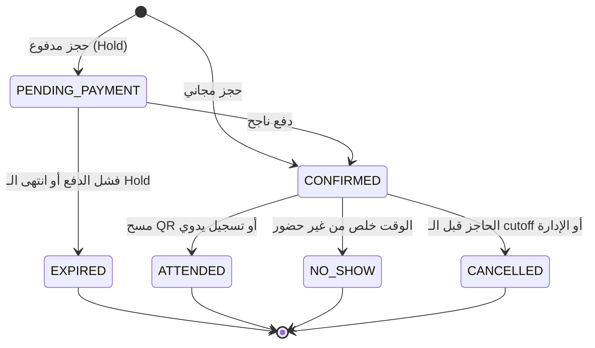

# سبرنت — BRD

Nov 8, 2026 · @Osman

> الملف ده هو المرجع. أي تعديل في المتطلبات بيحصل هنا في PR. نسخة claude.ai (https://claude.ai/artifact/PbJrsCE5ACdTipXCaJ6KWx) لقطة من 8 نوفمبر 2026 للعرض بس.

## 1. نظرة عامة ونطاق

سبرنت تطبيق Flutter (Android / iOS / Web / Desktop) لحجز ودفع المنشآت الرياضية بجامعة طنطا إلكترونيًا بالكامل، **من غير أي دفع كاش**. هو الأداة التالتة في رسالة دكتوراه د. سارة الحاج، وهيتعرض كنظام كامل شغال في المناقشة، وبعدها يفضل كما هو لحد ما الجامعة تتبناه.

الوثيقة دي مرجع لينا إحنا الاتنين: عثمان بيقرا ويقرر، وClaude بينفذ منها specs عن طريق Spec Kit. أي حاجة عليها **\[افتراض\]** لسه محتاجة تأكيد، ومتجمعة في القسم 11.

### المراحل

| المرحلة | الهدف | الدفع | توثيق الشريحة |
| --- | --- | --- | --- |
| **P1 — العرض والمناقشة** | النظام كامل end-to-end ويتعرض على الخبراء | Payment gateway تجاري في وضع اختبار (sandbox)، من غير فلوس حقيقية | شيت CSV + مراجعة يدوية |
| **P2 — تبني الجامعة** | تشغيل فعلي داخل الجامعة | منصة التحصيل الإلكتروني الخاصة بالجامعة | ربط مباشر مع أنظمة الجامعة |

المبدأ الحاكم: **أي حاجة ممكن تتغير بعد المناقشة تبقى إعداد (setting) مش كود**. ده بيشمل أوضاع الحجز، السعة، الأسعار، سياسة الإلغاء، نافذة الحجز، ومزوّد الدفع.

**ترتيب البناء في P1:** الواجهة كلها الأول، بكل الشاشات، على داتا تجريبية واقعية. بعدها الـ backend (Supabase أو Firebase أو الاتنين، يتحدد وقتها). داتا د. سارة الحقيقية بتستبدل الداتا التجريبية لما توصل.

### داخل النطاق

- التسجيل والدخول، وتوثيق شريحة السعر (داخلي / خارجي).
- تصفح المنشآت والتوفر من غير حساب.
- الحجز بنوعين: **حصري** (الوحدة كلها لحاجز واحد، زي الملعب) و**بالسعة** (أماكن جوه الوحدة، زي الحارة).
- المنشآت المجانية (نطاق ساعات) والمنشآت بمدرب (مدرب ثم slot).
- الدفع الإلكتروني، الاسترداد، الإيصال، رقم الحجز وQR.
- الإشعارات (push، والـ SMS في P2) والتذكير.
- تسجيل الحضور بالـ QR مع بديل يدوي.
- إدارة المنشآت والوحدات والمواعيد والإغلاقات والأسعار والإعدادات.
- الأدوار بالنطاقات، والتقارير والـ KPIs والإيرادات حسب الجهة.
- العهدة وبلاغات التلف.
- تسويق أساسي: صفحات منشآت عامة، لينك مشاركة، وعروض على الأوقات الأقل إقبالًا **\[افتراض\]**.

### خارج النطاق

- أي ذكاء اصطناعي.
- الدفع الكاش بأي شكل.
- عقوبات الغياب (حاليًا). الغياب بيتسجل ويظهر في التقارير بس.
- الاشتراكات والباقات الشهرية.
- الربط مع أنظمة الجامعة ومنصة التحصيل، والـ SMS، وأي خدمة مدفوعة (كلها P2 بعد المناقشة).
- تطبيق منفصل لكل دور: واجهة واحدة والصلاحيات بتحدد اللي يظهر.

## 2. أصحاب المصلحة والهيكل التنظيمي

المنشآت مش ليها مالك واحد. فيه منشآت تبع إدارات مركزية (استاد الجامعة، الإدارة العامة لرعاية الشباب) ومنشآت تبع كليات. عشان كده كل منشأة لازم تنتمي لـ **جهة تابعة**، والجهة دي هي اللي بتتحسب عليها الإيرادات والتقارير والصلاحيات.

**التسلسل:** الجامعة ← جهة تابعة ← منشأة ← وحدة قابلة للحجز.

| الجهة | النوع | أمثلة على منشآتها |
| --- | --- | --- |
| إدارة استاد جامعة طنطا | مركزية | ملاعب، صالات **\[افتراض\]** |
| الإدارة العامة لرعاية الشباب | مركزية | **\[افتراض — من داتا د. سارة\]** |
| كلية التربية الرياضية | كلية | حمام سباحة، صالات **\[افتراض\]** |

التوزيع الحقيقي هييجي من الداتا اللي د. سارة بتجمعها.

### أصحاب المصلحة

| صاحب المصلحة | علاقته بالنظام | يقابله في مجتمع الدراسة |
| --- | --- | --- |
| طالب / موظف / عضو هيئة تدريس | حاجز بالسعر الداخلي | — |
| زائر خارجي | حاجز بالسعر الكامل | — |
| المدرب | حصصه وحضورها | — |
| نائب رئيس الجامعة لشؤون خدمة المجتمع وتنمية البيئة | إشراف على الجامعة كلها | بند 1 |
| العمداء ووكلاء الكليات لخدمة المجتمع | مسؤولين عن جهة (كلية) | بنود 2، 3 |
| مدير عام رعاية الشباب ومديري اللجان العليا | مسؤولين عن جهة مركزية | بنود 4، 5 |
| رؤساء أقسام رعاية الشباب بالكليات | تشغيل منشآت الكلية | بند 7 |
| الإداريين والأخصائيين (رعاية الشباب / الاستاد) | مديري منشآت | بنود 6، 8، 10 |
| مدير إدارة استاد الجامعة | مسؤول جهة الاستاد | بند 9 |
| شؤون الطلاب / الموارد البشرية | مصدر بيانات التوثيق | — |
| د. سارة الحاج | صاحبة المشروع البحثي، مصدر المتطلبات | — |
| الخبراء المحكّمين | بيقيّموا التطبيق في صورته المبدئية | — |

## 3. المصطلحات

الأسماء الإنجليزي هي اللي هتستخدم في الكود والـ specs.

| المصطلح | Code name | المعنى |
| --- | --- | --- |
| جهة تابعة | `OwningUnit` | كلية أو إدارة مركزية بتملك منشآت وبتتحسب عليها الإيرادات |
| منشأة | `Facility` | مكان رياضي واحد (حمام سباحة، ملعب، صالة) |
| وحدة قابلة للحجز | `BookableUnit` | الحاجة اللي بتتحجز فعلًا جوه المنشأة: حارة، ملعب، صالة |
| وضع الحجز | `BookingMode` | `EXCLUSIVE` (الوحدة كلها لحاجز واحد) أو `SHARED` (أماكن بسعة) |
| السعة | `capacity` | عدد الأماكن المتاحة في الوحدة لكل slot في وضع `SHARED` |
| Slot | `Slot` | فترة زمنية قابلة للحجز على وحدة. بتتحسب من مواعيد التشغيل، مش متخزنة |
| منشأة مجانية | `isFree` | منشأة سعرها صفر، الحجز فيها نطاق ساعات ومفيش خطوة دفع |
| منشأة بمدرب | `requiresTrainer` | الحجز لازم يمر باختيار مدرب، والـ slot مدته ثابتة |
| الشريحة | `PriceTier` | `INTERNAL` (طالب / موظف / عضو هيئة تدريس) أو `EXTERNAL` (زائر خارجي) |
| التوثيق | `Verification` | إثبات إن الحساب داخلي عشان ياخد السعر المخفض |
| حجز مؤقت | `Hold` | حجز للمكان لمدة محدودة أثناء الدفع عشان محدش ياخده |
| نطاق الصلاحية | `Scope` | الجامعة كلها، أو جهة، أو منشآت محددة |
| إغلاق | `Closure` | فترة المنشأة أو الوحدة فيها مقفولة (صيانة، بطولة، إجازة) |
| عهدة | `Asset` | أي أداة أو جهاز مسجل على منشأة وليه مسؤول |
| بلاغ تلف | `DamageReport` | بلاغ عن تلف أو فقد في عهدة |
| إعداد | `Setting` | قيمة قابلة للتغيير من لوحة الأدمن، ليها قيمة افتراضية ونطاق |

## 4. قواعد العمل والإعدادات

كل قاعدة رقمها أو سلوكها ممكن يتغير بتبقى `Setting` في لوحة الأدمن. الإعدادات بتتوارث على 3 مستويات: **الجامعة ← المنشأة ← الوحدة**، والمستوى الأقرب بيغلب. التغيير بيسري على الحجوزات الجديدة بس، وأي حجز مؤكد قبله بيتحترم بشروطه الأصلية.

### 4.1 أوضاع الحجز

- **BR-01:** كل وحدة ليها `BookingMode` واحد: `EXCLUSIVE` أو `SHARED`.
- **BR-02 (EXCLUSIVE):** الـ slot بيتحجز مرة واحدة لحاجز واحد. فيه `maxParticipants` للعرض والتوعية (مثلًا الملعب يساع فريقين = 22) **\[افتراض: الرقم من داتا د. سارة\]**.
- **BR-03 (SHARED):** الـ slot ليه `capacity`. كل حجز بياخد مكان واحد، والـ slot بيتقفل لما الأماكن تخلص.
- **BR-04:** تغيير وضع الحجز أو تقليل السعة مسموح بس على الـ slots اللي مفيهاش حجوزات. لو فيه حجوزات أكتر من السعة الجديدة، النظام يرفض التغيير ويعرض الحجوزات المتعارضة.

**رأيي في الحارة:** نبدأ بـ `SHARED` بسعة. السبب إن مشكلة البحث بتتكلم صراحة عن "تنظيم أعداد الممارسين داخل الحارات"، وده مش هيبان غير لو فيه سعة. ولو اتضح إن الحارة بتتأجر كاملة، نقلب الإعداد لـ `EXCLUSIVE` من اللوحة من غير أي تعديل كود.

### 4.2 الـ Slots والمواعيد

- **BR-05:** الـ slots بتتولد من مواعيد التشغيل الأسبوعية للوحدة، ناقص الإغلاقات.
- **BR-06:** `bookingWindowDays` افتراضي **7**. مفيش حجز بعد النافذة دي.
- **BR-07:** الـ slots اللي وقتها عدّى بتظهر معطلة. وفيه `minLeadMinutes` (افتراضي **0**) لمنع الحجز قبل البداية بدقايق.
- **BR-08 (منشأة مجانية):** الحاجز يختار نطاق ساعات متتالية. `slotGranularityMinutes` افتراضي **60**، و`maxRangeHours` افتراضي **3** **\[افتراض\]**. النطاق كله لازم يكون متاح وإلا الحجز يترفض.
- **BR-09 (منشأة بمدرب):** الحاجز يختار المدرب الأول، بعدين slot مدته ثابتة `sessionMinutes` (افتراضي **60**). سعة الحصة = الأقل بين المتاح في الوحدة و`trainerCapacity` للمدرب.
- **BR-10:** المنشأة المجانية والمنشأة بمدرب مساران منفصلان في الواجهة.

### 4.3 منع التعارض

- **BR-11:** التحقق من التوفر بيحصل على السيرفر لحظة إنشاء الحجز، مش على الواجهة بس.
- **BR-12:** أول ما الحاجز يدخل على الدفع، المكان بيتحجز مؤقتًا (`Hold`) لمدة `holdMinutes` (افتراضي **10**). لو الدفع فشل أو الوقت خلص، الـ Hold بيتلغي والمكان يرجع متاح.
- **BR-13:** نفس الحاجز ميقدرش يحجز slotين متداخلين في الوقت، حتى لو في منشآت مختلفة.
- **BR-14:** `maxActiveBookingsPerUser` افتراضي **فاضي (بلا حد)**. موجود كإعداد لو احتجناه.

### 4.4 التسعير

- **BR-15:** الشرائح اتنين بس: `INTERNAL` و`EXTERNAL`. طالب وموظف وعضو هيئة تدريس سعر داخلي واحد.
- **BR-16:** السعر بيتحدد لكل وحدة ولكل شريحة: في `EXCLUSIVE` السعر للـ slot كله، وفي `SHARED` السعر للمكان الواحد.
- **BR-17:** الشريحة بتتحدد من حالة توثيق الحاجز **وقت الحجز**، والسعر بيتثبت في الحجز ومش بيتغير بعدها.
- **BR-18:** في `EXCLUSIVE` السعر بيتحسب على شريحة الحاجز بس، حتى لو باقي الفريق من بره **\[افتراض\]**.
- **BR-19:** المنشأة المجانية مفيهاش خطوة دفع، والحجز بيتأكد على طول.
- **BR-20:** عرض (`Offer`) يقدر يخصم نسبة على slots في أيام وساعات محددة، لشريحة أو للكل **\[افتراض\]**.

### 4.5 التوثيق

- **BR-21:** أي حساب جديد بيبدأ `EXTERNAL` ويقدر يحجز فورًا بالسعر الكامل.
- **BR-22:** طلب التوثيق فيه: النوع (طالب / موظف / عضو هيئة تدريس)، الرقم القومي، الكود الجامعي أو الوظيفي، الكلية أو الإدارة، وصورة الكارنيه.
- **BR-23:** لو الرقم القومي والكود مطابقين لصف في شيت مرفوع، التوثيق بيتم تلقائيًا. غير كده بيروح لمسؤول التوثيق.
- **BR-24:** أثناء المراجعة الحساب بيفضل `EXTERNAL`. بعد الموافقة الأسعار الداخلية بتسري على الحجوزات الجديدة بس.
- **BR-25:** التوثيق صالح لحد `verificationExpiry` (افتراضي: نهاية السنة الدراسية، **31 أغسطس** **\[افتراض\]**)، وبعدها الحساب يرجع `EXTERNAL` لحد ما يتجدد.
- **BR-26:** الرفض لازم يكون معاه سبب يظهر للمستخدم.
- **BR-27:** الرقم القومي ميتكررش على أكتر من حساب.

### 4.6 الدفع والاسترداد

- **BR-28:** مفيش كاش. أي حجز مدفوع بيتأكد بس بعد تأكيد الدفع من المزوّد (webhook / callback)، مش من الواجهة.
- **BR-29:** مزوّد الدفع خلف واجهة موحدة (`PaymentProvider`). P1 = gateway تجاري، P2 = منصة التحصيل الإلكتروني للجامعة. التبديل إعداد، مش تعديل في فلو الحجز.
- **BR-30:** الإلغاء مسموح لحد `cancellationCutoffHours` قبل البداية (افتراضي **2** **\[افتراض\]**). بعده زرار الإلغاء بيختفي.
- **BR-31:** الاسترداد = `refundPercent` من المبلغ (افتراضي **100%**) لو الإلغاء قبل الـ cutoff. الاسترداد بيرجع على نفس وسيلة الدفع.
- **BR-32:** لو الإدارة لغت حجز (إغلاق طارئ مثلًا)، الاسترداد **100%** دايمًا، بغض النظر عن الإعدادات.
- **BR-33:** كل عملية دفع أو استرداد بتتسجل وبتتنسب للجهة المالكة للمنشأة.

### 4.7 الحضور

- **BR-34:** الحضور بيتسجل بمسح QR الحجز. لو المسح فشل، تسجيل يدوي برقم الحجز، والتسجيل اليدوي بيتعلّم إنه يدوي.
- **BR-35:** نافذة تسجيل الحضور من `checkInOpensMinutes` قبل البداية (افتراضي **15**) لحد نهاية الـ slot.
- **BR-36:** شاشة المسح بتعرض اسم الحاجز وصورته وشريحته، عشان المسؤول يطابقهم بالكارنيه.
- **BR-37:** الحجز المؤكد اللي معداش عليه حضور لحد نهاية الـ slot بيتحول `NO_SHOW` تلقائيًا. **مفيش عقوبة**، بيظهر في التقارير بس.
- **BR-38:** الحجز غير قابل للتحويل لشخص تاني.

### 4.8 الإشعارات

- **BR-39:** تأكيد الحجز: push في P1، ويتضاف SMS في P2. التذكير قبل البداية بـ `reminderLeadMinutes` (افتراضي **60**).
- **BR-40:** التذكير بيعرض زرار الإلغاء بس لو لسه قبل الـ cutoff.
- **BR-41:** إلغاء من الإدارة أو تغيير في الحجز: إشعار push فوري (و SMS في P2).

### 4.9 العهدة

- **BR-42:** كل عهدة مسجلة على منشأة، وليها مسؤول (موظف)، وحالة: `OK` / `DAMAGED` / `UNDER_REPAIR` / `LOST` / `RETIRED`.
- **BR-43:** بلاغ التلف بيتعمل من مدرب أو مدير منشأة، بصورة ووصف، وحالته: `OPEN` → `IN_PROGRESS` → `RESOLVED` / `REJECTED`.
- **BR-44:** لو البلاغ بيخلي الوحدة مش صالحة، مدير المنشأة يقدر يعمل إغلاق عليها من نفس البلاغ.

## 5. نموذج البيانات

ده نموذج على مستوى البيزنس، مش schema نهائية. الـ `Slot` بيتحسب ومش متخزن، والحجز هو اللي بيتخزن.

| الكيان | أهم الحقول | ملاحظات |
| --- | --- | --- |
| `OwningUnit` | name, type (`FACULTY` / `CENTRAL`) | الإيرادات والتقارير بتتجمع عليها |
| `Facility` | owningUnitId, name, type, description, photos, location, isFree, requiresTrainer, isPublished | `type`: سباحة، كرة قدم، صالة… |
| `BookableUnit` | facilityId, name, bookingMode, capacity, maxParticipants, isActive | حارة 1، ملعب A |
| `OperatingHours` | unitId أو facilityId, dayOfWeek, openTime, closeTime | جدول أسبوعي |
| `Closure` | scope (facility / unit), from, to, reason | الـ slots اللي فيه بتختفي |
| `Price` | unitId, tier, amount, currency | لكل وحدة × شريحة |
| `Offer` | scope, discountPercent, days, timeRange, tier?, validFrom, validTo | تسويق الأوقات الأقل إقبالًا |
| `Trainer` | userId, facilityIds, bio, photo, trainerCapacity |  |
| `TrainerAvailability` | trainerId, unitId, dayOfWeek, from, to | المدرب متاح فين وإمتى |
| `User` | name, phone, email, photo, nationalId?, tier, status | `tier` مشتق من التوثيق |
| `Verification` | userId, type, nationalId, code, faculty, idCardPhoto, status, method (`AUTO` / `MANUAL`), reviewerId, reason, expiresAt |  |
| `VerificationWhitelist` | nationalId, code, type, uploadedBy, batchId | الشيت المرفوع |
| `RoleAssignment` | userId, role, scopeType (`UNIVERSITY` / `OWNING_UNIT` / `FACILITY`), scopeId | مستخدم ممكن يبقى ليه أكتر من دور |
| `Booking` | code, userId, unitId, trainerId?, start, end, seats, tierAtBooking, priceAtBooking, status, qrToken, cancelledBy?, cancelReason? | السعر والشريحة متثبتين |
| `Payment` | bookingId, provider, providerRef, amount, status, paidAt, owningUnitId |  |
| `Refund` | paymentId, amount, reason, status |  |
| `Attendance` | bookingId, status (`PRESENT` / `NO_SHOW`), method (`QR` / `MANUAL` / `AUTO`), markedBy, markedAt |  |
| `Notification` | userId, type, channel (`PUSH` / `SMS`), payload, sentAt, readAt |  |
| `Asset` | facilityId, name, code, quantity, custodianId, status |  |
| `DamageReport` | assetId, reportedBy, description, photos, status, linkedClosureId? |  |
| `Setting` | key, value, scopeType, scopeId | الوراثة: جامعة ← منشأة ← وحدة |
| `AuditLog` | actorId, action, entity, entityId, before, after, at | أي تعديل إداري |

### حالات الحجز

| الحالة | المعنى | بتيجي من |
| --- | --- | --- |
| `PENDING_PAYMENT` | فيه Hold والدفع لسه مخلصش | إنشاء حجز مدفوع |
| `CONFIRMED` | مؤكد | دفع ناجح، أو حجز مجاني |
| `EXPIRED` | الـ Hold خلص من غير دفع | `PENDING_PAYMENT` |
| `CANCELLED` | اتلغى من الحاجز أو الإدارة | `CONFIRMED` |
| `ATTENDED` | الحضور اتسجل | `CONFIRMED` |
| `NO_SHOW` | الوقت خلص من غير حضور | `CONFIRMED` |

الحالات النهائية أربعة: `EXPIRED` و `ATTENDED` و `NO_SHOW` و `CANCELLED`. الاسترداد بيحصل بس في `CANCELLED` حسب BR-31 و BR-32.

## 6. الأدوار والصلاحيات

الصلاحية = **دور × نطاق**. نفس الدور بنطاقين مختلفين بيشوف داتا مختلفة: العميد ومدير الاستاد الاتنين `UNIT_ADMIN`، بس كل واحد على جهته. ومستخدم واحد ممكن يبقى ليه أكتر من دور (مدرب وحاجز مثلًا).

| الدور | Code | النطاق |
| --- | --- | --- |
| ضيف | `GUEST` | من غير حساب |
| حاجز | `BOOKER` | حجوزاته هو |
| مدرب | `TRAINER` | حصصه هو |
| مدير منشأة | `FACILITY_MANAGER` | منشأة أو أكتر |
| مسؤول توثيق | `VERIFIER` | جهة أو الجامعة |
| مسؤول جهة | `UNIT_ADMIN` | جهة واحدة |
| مشرف عام | `SUPER_ADMIN` | الجامعة كلها |
| مراقب | `VIEWER` | قراءة فقط على نطاقه **\[اختياري\]** |

"ممثل الوزارة" اتشال، لأنه مش في مجتمع الدراسة. لو لازم يرجع، يبقى `VIEWER` على نطاق الجامعة.

### المصفوفة

✓ = مسموح في نطاقه · — = لأ

| القدرة | GUEST | BOOKER | TRAINER | FACILITY\_MANAGER | VERIFIER | UNIT\_ADMIN | SUPER\_ADMIN |
| --- | --- | --- | --- | --- | --- | --- | --- |
| تصفح المنشآت والتوفر | ✓ | ✓ | ✓ | ✓ | ✓ | ✓ | ✓ |
| حجز ودفع وإلغاء | — | ✓ | ✓ | ✓ | ✓ | ✓ | ✓ |
| طلب توثيق | — | ✓ | ✓ | ✓ | ✓ | ✓ | ✓ |
| مراجعة التوثيق ورفع الشيت | — | — | — | — | ✓ | — | ✓ |
| مسح QR وتسجيل حضور | — | — | ✓ حصصه | ✓ | — | — | — |
| عرض حجوزات المنشأة | — | — | ✓ حصصه | ✓ | — | ✓ | ✓ |
| إلغاء حجز من الإدارة | — | — | — | ✓ | — | ✓ | ✓ |
| مواعيد التشغيل والإغلاقات | — | — | — | ✓ | — | ✓ | ✓ |
| الأسعار والعروض والإعدادات | — | — | — | — | — | ✓ | ✓ |
| إضافة منشأة / وحدة | — | — | — | — | — | ✓ | ✓ |
| إدارة المدربين وتوافرهم | — | — | — | ✓ | — | ✓ | ✓ |
| العهدة | — | — | — | ✓ | — | ✓ | ✓ |
| بلاغ تلف | — | — | ✓ | ✓ | — | ✓ | ✓ |
| معالجة بلاغ تلف | — | — | — | ✓ | — | ✓ | ✓ |
| التقارير والإيرادات والـ KPIs | — | — | ✓ حصصه | ✓ | — | ✓ | ✓ |
| تعيين الأدوار | — | — | — | — | — | ✓ تحت جهته | ✓ |
| إنشاء جهة تابعة | — | — | — | — | — | — | ✓ |
| سجل التعديلات (Audit) | — | — | — | — | — | ✓ | ✓ |

`VIEWER` = نفس عمود التقارير وعرض الحجوزات بتوع `UNIT_ADMIN`، من غير أي تعديل.

## 7. المتطلبات الوظيفية

كل موديول = feature في Spec Kit تقريبًا. الأولوية: **M** = Must للمناقشة، **S** = Should، **C** = Could.

| ID | الموديول | المتطلب | أولوية |
| --- | --- | --- | --- |
| FR-AUTH-01 | الدخول | تسجيل بالاسم والموبايل والإيميل والباسورد، مع تأكيد الإيميل (OTP الموبايل في P2 لأنه SMS مدفوع) | M |
| FR-AUTH-02 | الدخول | دخول من فورم واحد بإيميل أو موبايل + باسورد، مع حالة تحميل وأخطاء واضحة | M |
| FR-AUTH-03 | الدخول | استرجاع الباسورد بلينك أو كود على الإيميل (OTP الموبايل في P2) | M |
| FR-AUTH-04 | الدخول | بعد الدخول، الواجهة بتتبني على أدوار المستخدم ونطاقاتها | M |
| FR-VER-01 | التوثيق | فورم طلب التوثيق ورفع صورة الكارنيه (BR-22) | M |
| FR-VER-02 | التوثيق | رفع شيت CSV، والمطابقة التلقائية للطلبات الحالية والجديدة (BR-23) | M |
| FR-VER-03 | التوثيق | قائمة مراجعة يدوية: موافقة / رفض بسبب | M |
| FR-VER-04 | التوثيق | انتهاء التوثيق وتجديده (BR-25) | S |
| FR-CAT-01 | المنشآت | قائمة المنشآت مع فلتر بالنوع والجهة ومجاني / مدفوع | M |
| FR-CAT-02 | المنشآت | صفحة منشأة: صور، وصف، مواعيد، أسعار الشريحتين، المدربين، موقع | M |
| FR-CAT-03 | المنشآت | الهوم: الضيف يشوف اكتشاف، والمسجل يشوف حجوزاته الجاية واقتراحات | M |
| FR-CAT-04 | المنشآت | لينك مشاركة لكل منشأة يفتح صفحتها على الويب أو التطبيق | S |
| FR-AVL-01 | التوفر | عرض الـ slots لـ 7 أيام، بالمتاح والمحجوز والمعطل، والأماكن المتبقية في SHARED | M |
| FR-AVL-02 | التوفر | التوفر بيتحدث لحظيًا أو عند فتح الشاشة، ومنع الحجز المتعارض على السيرفر (BR-11) | M |
| FR-BKG-01 | الحجز | حجز EXCLUSIVE و SHARED حسب إعداد الوحدة | M |
| FR-BKG-02 | الحجز | حجز نطاق ساعات في المنشأة المجانية (BR-08) | M |
| FR-BKG-03 | الحجز | اختيار مدرب ثم slot في المنشأة بمدرب (BR-09) | M |
| FR-BKG-04 | الحجز | ملخص قبل التأكيد: المنشأة، الوحدة، الوقت، المدرب، الشريحة، السعر، سياسة الإلغاء | M |
| FR-BKG-05 | الحجز | الـ Hold أثناء الدفع وانتهاؤه (BR-12) | M |
| FR-PAY-01 | الدفع | الدفع عن طريق `PaymentProvider` (BR-29) | M |
| FR-PAY-02 | الدفع | النجاح بيأكد الحجز، والفشل بيرجّع لنفس الملخص مع إعادة المحاولة | M |
| FR-PAY-03 | الدفع | إيصال إلكتروني لكل دفعة | S |
| FR-PAY-04 | الدفع | الاسترداد عند الإلغاء حسب BR-31 و BR-32 | M |
| FR-MYB-01 | حجوزاتي | شاشة تأكيد: رقم الحجز + QR + التفاصيل | M |
| FR-MYB-02 | حجوزاتي | قائمة حجوزات جاية وسابقة، مع الإلغاء لو مسموح | M |
| FR-MYB-03 | حجوزاتي | البروفايل: البيانات، الصورة، حالة التوثيق، اللغة | M |
| FR-NTF-01 | الإشعارات | push للتأكيد والتذكير والإلغاء، و SMS في P2 (BR-39 — BR-41) | M |
| FR-NTF-02 | الإشعارات | مركز إشعارات داخل التطبيق | M |
| FR-ATT-01 | الحضور | مسح QR مع عرض اسم وصورة وشريحة الحاجز (BR-36) | M |
| FR-ATT-02 | الحضور | تسجيل يدوي برقم الحجز أو من قائمة الحصة | M |
| FR-ATT-03 | الحضور | تحويل تلقائي لـ NO\_SHOW (BR-37) | M |
| FR-TRN-01 | المدرب | داشبورد: حصص النهارده والجاية، وعدد الحاضرين | M |
| FR-TRN-02 | المدرب | قائمة حضور كل حصة | M |
| FR-OPS-01 | التشغيل | إدارة الجهات والمنشآت والوحدات | M |
| FR-OPS-02 | التشغيل | مواعيد التشغيل الأسبوعية والإغلاقات | M |
| FR-OPS-03 | التشغيل | الأسعار لكل وحدة × شريحة | M |
| FR-OPS-04 | التشغيل | لوحة الإعدادات بالوراثة (القسم 4) | M |
| FR-OPS-05 | التشغيل | إدارة المدربين وتوافرهم | M |
| FR-OPS-06 | التشغيل | متابعة حجوزات المنشأة بالتاريخ، وإلغاء إداري بسبب | M |
| FR-OPS-07 | التشغيل | تعيين الأدوار والنطاقات | M |
| FR-OPS-08 | التشغيل | سجل التعديلات الإدارية | S |
| FR-RPT-01 | التقارير | KPIs: نسبة الإشغال، عدد الحجوزات، الإيراد، نسبة الحضور والغياب، الإلغاءات | M |
| FR-RPT-02 | التقارير | فلترة بالفترة والجهة والمنشأة والشريحة، حسب نطاق المستخدم | M |
| FR-RPT-03 | التقارير | الإيراد حسب الجهة والمنشأة، واسترداداته | M |
| FR-RPT-04 | التقارير | الأوقات الأكثر والأقل إقبالًا (heatmap يوم × ساعة) | S |
| FR-RPT-05 | التقارير | تصدير CSV / PDF | S |
| FR-AST-01 | العهدة | سجل العهدة لكل منشأة ومسؤولها وحالتها | M |
| FR-AST-02 | العهدة | بلاغ تلف بصورة، ومتابعة حالته، وربطه بإغلاق (BR-44) | M |
| FR-MKT-01 | التسويق | العروض على الأوقات الأقل إقبالًا (BR-20) | S |
| FR-MKT-02 | التسويق | إشعار ترويجي لشريحة أو للكل عن عرض أو منشأة جديدة | C |

## 8. User Stories

كل story بتشاور على المتطلبات اللي بتغطيها. معايير القبول بصيغة Given / When / Then عشان تتنقل مباشرة للـ spec والـ tests.

### Epic A — الدخول والتوثيق

**US-01 — ضيف يتصفح من غير حساب** · FR-CAT-01, FR-CAT-02, FR-AVL-01

- Given ضيف فاتح التطبيق، When يفتح منشأة، Then يشوف تفاصيلها والـ slots لـ 7 أيام وأسعار الشريحتين.
- Given ضيف، When يدوس على slot متاح، Then يتطلب منه الدخول، وبعد الدخول يرجع لنفس الـ slot.

**US-02 — تسجيل حساب** · FR-AUTH-01

- Given مستخدم جديد، When يدخل بيانات صحيحة ويأكد الإيميل، Then الحساب يتعمل بشريحة `EXTERNAL`.
- Given موبايل أو إيميل مستخدم قبل كده، When يحاول يسجل، Then يظهر خطأ واضح ومفيش حساب جديد.

**US-03 — دخول من فورم واحد** · FR-AUTH-02, FR-AUTH-04

- Given حساب موجود، When يدخل إيميل أو موبايل + باسورد صح، Then يظهر loading ويدخل على الهوم المناسب لأدواره.
- Given بيانات غلط، Then رسالة خطأ من غير ما توضح أنهي حقل الغلط.

**US-04 — طلب توثيق** · FR-VER-01, FR-VER-02

- Given حاجز `EXTERNAL`، When يبعت طلب توثيق كامل وبياناته موجودة في الشيت، Then يتوثق فورًا ويشوف السعر الداخلي.
- Given بياناته مش في الشيت، Then الطلب يبقى قيد المراجعة، ويفضل يحجز بالسعر الكامل.
- Given رقم قومي مستخدم في حساب تاني، Then الطلب يترفض تلقائيًا بسبب واضح.

**US-05 — مسؤول توثيق يراجع** · FR-VER-02, FR-VER-03

- Given طلب قيد المراجعة، When المسؤول يوافق، Then الحساب يبقى `INTERNAL` ويوصل إشعار للمستخدم.
- When يرفض، Then لازم يكتب سبب، والسبب يظهر للمستخدم.
- When يرفع شيت جديد، Then كل الطلبات المعلقة اللي بتطابق تتوثق تلقائيًا.

### Epic B — الحجز والدفع

**US-06 — حجز وحدة حصرية (ملعب)** · FR-BKG-01, FR-BKG-04, FR-PAY-01, FR-PAY-02

- Given وحدة `EXCLUSIVE` وslot متاح، When الحاجز يأكد ويدفع بنجاح، Then الحجز `CONFIRMED` والـ slot يبقى محجوز لكل الناس.
- Given اتنين بيحاولوا يحجزوا نفس الـ slot في نفس اللحظة، Then واحد بس ينجح، والتاني يشوف رسالة إن الـ slot اتحجز.

**US-07 — حجز مكان في وحدة بسعة (حارة)** · FR-BKG-01, FR-AVL-01

- Given وحدة `SHARED` بسعة 6 وفيها 5 حجوزات، When حاجز يحجز، Then الحجز ينجح والـ slot يبقى ممتلي.
- Given الـ slot ممتلي، Then يظهر "مكتمل" ومش قابل للاختيار.

**US-08 — حجز نطاق ساعات في منشأة مجانية** · FR-BKG-02

- Given منشأة مجانية، When الحاجز يختار من 4 لـ 6، Then الحجز يتأكد على طول من غير دفع.
- Given ساعة جوه النطاق مش متاحة، Then النطاق ميتقبلش وتظهر الساعة المتعارضة.
- Given نطاق أطول من `maxRangeHours`، Then الاختيار يتمنع.

**US-09 — حجز مع مدرب (سباحة)** · FR-BKG-03

- Given منشأة بمدرب، When الحاجز يختار مدرب، Then يشوف بس الـ slots اللي المدرب متاح فيها وفيها مكان.
- Given المدرب وصل لـ `trainerCapacity`، Then الـ slot يظهر مكتمل حتى لو الحارة فيها مكان.

**US-10 — فشل الدفع أو انتهاء المهلة** · FR-BKG-05, FR-PAY-02

- Given حجز `PENDING_PAYMENT`، When الدفع يفشل، Then يرجع لشاشة الملخص بنفس الاختيارات ويقدر يعيد المحاولة طول ما الـ Hold شغال.
- Given الـ Hold خلص، Then الحجز يبقى `EXPIRED` والمكان يرجع متاح.

**US-11 — السعر حسب الشريحة** · BR-15 — BR-17

- Given حاجز `INTERNAL`، Then كل الأسعار اللي بيشوفها والملخص بالسعر الداخلي.
- Given حجز اتعمل وهو `EXTERNAL` وبعدين اتوثق، Then سعر الحجز القديم مبيتغيرش.

### Epic C — بعد الحجز

**US-12 — شاشة التأكيد والإشعارات** · FR-MYB-01, FR-NTF-01

- Given دفع ناجح، Then تظهر شاشة فيها رقم الحجز وQR والتفاصيل، ويوصل push.

**US-13 — التذكير والإلغاء** · FR-NTF-01, FR-PAY-04

- Given حجز مؤكد، When يفاضل `reminderLeadMinutes`، Then يوصل تذكير.
- Given لسه قبل الـ cutoff، When الحاجز يلغي، Then الحجز يبقى `CANCELLED` والاسترداد يتعمل بالنسبة المحددة.
- Given بعد الـ cutoff، Then زرار الإلغاء مش ظاهر.

**US-14 — حجوزاتي وإشعاراتي وبروفايلي** · FR-MYB-02, FR-MYB-03, FR-NTF-02

- Then الحاجز يشوف حجوزاته الجاية والسابقة بحالاتها، وإشعاراته، وحالة توثيقه.

### Epic D — المدرب والحضور

**US-15 — تسجيل الحضور بالـ QR** · FR-ATT-01

- Given حجز مؤكد ونافذة الحضور مفتوحة، When المدرب يمسح الـ QR، Then يشوف اسم الحاجز وصورته وشريحته، ولما يأكد الحجز يبقى `ATTENDED`.
- Given QR لحجز في منشأة تانية أو يوم تاني، Then يظهر خطأ ومفيش تسجيل.
- Given الحضور اتسجل قبل كده، Then يظهر "مسجل بالفعل" بالوقت.

**US-16 — بديل يدوي** · FR-ATT-02

- Given المسح فشل، When المدرب يدخل رقم الحجز أو يختار من قائمة الحصة، Then الحضور يتسجل بطريقة `MANUAL`.

**US-17 — داشبورد المدرب** · FR-TRN-01, FR-TRN-02

- Then المدرب يشوف حصصه النهارده والجاية، وقائمة كل حصة بحالة كل حاجز.

### Epic E — الإدارة

**US-18 — مدير منشأة يتابع الحجوزات** · FR-OPS-06, FR-ATT-02

- Given مدير منشأة، Then يشوف حجوزات منشآته بس، بالتاريخ والوحدة والحالة.
- When يلغي حجز إداريًا، Then لازم سبب، والاسترداد 100%، ويوصل إشعار للحاجز.

**US-19 — مواعيد وإغلاقات** · FR-OPS-02

- When مدير يضيف إغلاق على وحدة، Then الـ slots بتاعته تختفي، ولو فيه حجوزات مؤكدة يظهر تحذير بعددها قبل التأكيد، وتتلغي باسترداد كامل لو أكد.

**US-20 — الأسعار والإعدادات** · FR-OPS-03, FR-OPS-04

- Given مسؤول جهة، When يغير وضع حجز الحارة من `SHARED` لـ `EXCLUSIVE`، Then التغيير يسري على الـ slots الفاضية بس (BR-04).
- When يغير إعداد على مستوى منشأة، Then الوحدات اللي ملهاش قيمة خاصة بيها تاخده.

**US-21 — التقارير حسب النطاق** · FR-RPT-01 — FR-RPT-03

- Given عميد كلية، Then التقارير والإيرادات لجهته بس.
- Given مشرف عام، Then يشوف الجامعة كلها ويقارن بين الجهات.

**US-22 — العهدة وبلاغات التلف** · FR-AST-01, FR-AST-02

- Given مدرب لقى أداة تالفة، When يعمل بلاغ بصورة، Then البلاغ يوصل لمدير المنشأة بحالة `OPEN`.
- When المدير يعتبر الوحدة مش صالحة، Then يعمل إغلاق من البلاغ نفسه.

**US-23 — زائر خارجي يحجز بالسعر الكامل** · BR-21

- Given حساب `EXTERNAL`، Then يقدر يحجز أي منشأة منشورة بالسعر الكامل من غير أي توثيق.

**US-24 — عرض على أوقات قليلة الإقبال** · FR-MKT-01

- Given عرض 30% على الحارات من 8 لـ 10 مساءً، Then الحاجز يشوف السعر الأصلي مشطوب والسعر بعد الخصم في الـ slots دي بس.

## 9. المتطلبات غير الوظيفية

| ID | البند | المتطلب |
| --- | --- | --- |
| NFR-01 | المنصات | Android و iOS (موبايل وتابلت و iPad)، والموبايلات القابلة للطي، و Web، و Desktop من نفس الكود. الـ layout بيتغير بحجم الشاشة مش بنوع الجهاز، والويب يغطي لوحة الإدارة بالكامل. الشكل بيتبع كل نظام: iOS بشكل iOS و Android بشكل Android، مش Material على الكل |
| NFR-02 | اللغة | عربي RTL أساسي وإنجليزي ثانوي، ولهجة مصرية خفيفة في نصوص الواجهة. Light و Dark، بيتبعوا إعداد الجهاز مع اختيار يدوي. كل النصوص في ملفات ترجمة، مفيش نص hardcoded |
| NFR-03 | الوقت | كل المواعيد بتوقيت القاهرة (`Africa/Cairo`) وبتتخزن UTC |
| NFR-04 | العملة | الجنيه المصري، والأرقام بتتعرض حسب لغة الواجهة |
| NFR-05 | الصحة | الحجز والدفع والاسترداد والصلاحيات بتتحقق على السيرفر. الواجهة مش مصدر ثقة |
| NFR-06 | الخصوصية | الرقم القومي وصورة الكارنيه ميشوفهمش غير `VERIFIER` و `SUPER_ADMIN`. الرقم القومي بيظهر متقنّع في أي مكان تاني |
| NFR-07 | الأمان | QR الحجز فيه token موقّع مش رقم الحجز الخام، عشان ميتزورش |
| NFR-08 | الدفع | مفيش بيانات كروت بتتخزن عندنا. كل الدفع على صفحة أو SDK المزوّد |
| NFR-09 | الأداء | شاشة التوفر تفتح في أقل من 2 ثانية على 4G، والحجز المتعارض يتمنع 100% |
| NFR-10 | الوصولية | تباين ألوان كافي، أحجام لمس 48dp على الأقل، ودعم قارئ الشاشة للعناصر الأساسية |
| NFR-11 | المعمارية | Flutter + Riverpod (codegen) + Freezed + GoRouter + Clean Architecture. الـ backend خلف repositories عشان Supabase أو غيره يتركب بعدين |
| NFR-12 | التتبع | أي تعديل إداري بيتسجل في `AuditLog` |
| NFR-13 | داتا العرض | seed data تجريبية واقعية دلوقتي، بتتبدل بداتا د. سارة لما توصل، عشان العرض على الخبراء يبان حقيقي |
| NFR-14 | طريقة الشغل | Spec Kit بالترتيب: specify → clarify → plan → tasks → implement. فرع وPR لكل feature، وقسم Out of scope إجباري، ومفيش rewrite للتاريخ |
| NFR-15 | النشر | `develop` بيتنشر تلقائيًا على GitHub Pages |

## 10. الربط بمشكلة البحث

كل مشكلة اتذكرت في خطة البحث أو صفحة "مشكلة البحث" الجديدة ليها feature بتحلها. الجدول ده هيفيد د. سارة في المناقشة وفي فصل وصف التطبيق.

| المشكلة كما في البحث | الحل في سبرنت | المرجع |
| --- | --- | --- |
| الاعتماد على الأساليب التقليدية في الحجز وتحديد المواعيد | حجز إلكتروني مع توفر لحظي | FR-AVL, FR-BKG |
| عدم مرونة تعديل المواعيد أو اختيار الأنسب | عرض 7 أيام والإلغاء الذاتي قبل الـ cutoff | BR-06, BR-30, US-13 |
| محدودية العدالة في توزيع المواعيد | منع التعارض على السيرفر، الـ Hold، وحد أقصى للحجوزات قابل للتفعيل | BR-11 — BR-14 |
| تحديات اختيار المدربين وتوزيع الفترات | مسار المدرب ثم الـ slot، وتوافر وسعة لكل مدرب | BR-09, FR-OPS-05, US-09 |
| تنظيم أعداد الممارسين داخل الحارات والملاعب | وضع `SHARED` بسعة، و`maxParticipants` للملاعب | BR-02, BR-03, US-07 |
| الدفع الورقي أو المباشر وضعف دقة البيانات المالية | دفع إلكتروني فقط، وكل عملية متسجلة ومنسوبة لجهة | BR-28 — BR-33 |
| تأخر توريد الإيرادات | تقارير إيراد لحظية حسب الجهة، وفي P2 التحصيل مباشرة لمنصة الجامعة | FR-RPT-03, BR-29 |
| الأمن المادي وفقدان السيطرة على الموارد والتجهيزات | سجل العهدة وبلاغات التلف | FR-AST, BR-42 — BR-44 |
| صعوبة توفير بيانات دقيقة عن معدلات الاستخدام | KPIs الإشغال والحضور والغياب والأوقات الأكثر إقبالًا | FR-RPT-01, FR-RPT-04 |
| ضعف تسويق الخدمات والوصول للفئات المستهدفة | تصفح من غير حساب، لينك مشاركة، عروض الأوقات الأقل إقبالًا | FR-CAT-04, FR-MKT |
| عدم استغلال أوقات التشغيل غير المستغلة | سعر خارجي للزوار وعروض على المسائي والإجازات | BR-15, BR-20 |
| عدم وجود تطبيق يربط الإدارة بالمستفيدين | واجهة واحدة بأدوار ونطاقات، وإشعارات في الاتجاهين | القسم 6, FR-NTF |
| الشعور بعدم تكافؤ الفرص | التحقق من الهوية عند الحضور، وعدم قابلية الحجز للتحويل، والتوثيق بدل الإقرار الذاتي | BR-21 — BR-27, BR-36, BR-38 |

## 11. الافتراضات والأسئلة المفتوحة

أغلب الأسئلة دي إجابتها قيمة إعداد، فمش بتوقف التنفيذ. ومفيش حاجة فيها بتوقف بناء الواجهة، لأننا شغالين على داتا تجريبية لحد ما داتا د. سارة توصل.

### محتاج من داتا د. سارة

- [ ] قائمة المنشآت، وكل منشأة تبع أنهي جهة.
- [ ] الوحدات في كل منشأة (عدد الحارات، الملاعب، الصالات).
- [ ] سعة الحارة، و`maxParticipants` للملعب.
- [ ] مواعيد التشغيل لكل منشأة.
- [ ] الأسعار الحالية: داخلي وخارجي لكل منشأة.
- [ ] المنشآت المجانية والمنشآت بمدرب.
- [ ] المدربين ومواعيدهم والسعة لكل مدرب.
- [ ] إيراد كل منشأة بيروح حساب الجهة ولا حساب مركزي.
- [ ] شؤون الطلاب والموارد البشرية هيدونا شيت للتوثيق ولا التوثيق كله يدوي في P1.

### قرارات محتاجة تتحسم

- [ ] مزوّد الدفع في P1 (العرض هيبقى في وضع اختبار، ده اتحسم).
- [ ] مزوّد الـ SMS (مؤجل لـ P2).
- [ ] تأكيد إن الحارة تبدأ `SHARED` (رأيي في القسم 4.1).
- [ ] قيم الإلغاء الافتراضية: cutoff ساعتين واسترداد 100%. **ملحوظة:** لو التذكير قبل ساعة والـ cutoff ساعتين، زرار الإلغاء عمره ما هيظهر في التذكير. لازم واحد فيهم يتظبط على التاني.
- [ ] أقصى نطاق ساعات في المنشأة المجانية (افتراضي 3).
- [ ] تاريخ انتهاء التوثيق (افتراضي 31 أغسطس).
- [ ] في الملعب، السعر على شريحة الحاجز بس ولا لو فيه حد من بره يتحسب خارجي.
- [ ] العروض على الأوقات الأقل إقبالًا داخل P1 ولا لأ.
- [ ] دور `VIEWER` محتاجينه ولا نشيله.
- [ ] Supabase ولا Firebase ولا الاتنين، بعد ما الواجهة تخلص.
